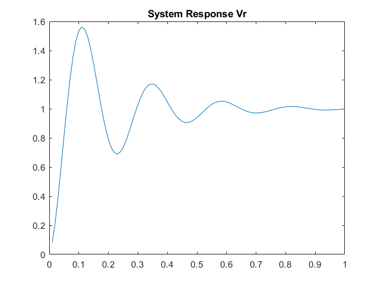

# Least-squares parameter estimation

MATLAB scripts that estimate unknown parameters with the least-squares method: the mass, damping and stiffness of a mass-spring-damper system, and the transfer matrix of an RLC circuit from measured voltages.



## Context

Coursework for Modelling and Simulation of Dynamical Systems at the Aristotle University of Thessaloniki, School of Electrical and Computer Engineering, spring semester 2021. Individual coursework.

The course provided the assignment text and, for the circuit task, the protected MATLAB function `v.p` that produces the measured voltages. The rest is written for the assignment.

The report is in [docs/report.md](docs/report.md) and the assignment in [docs/brief.md](docs/brief.md). Both were written in Greek; the files here are English translations.

## What it does

- **Mass-spring-damper:** simulates the system with `ode15s` for 10 s, samples the displacement every 0.1 s, filters the signals to get a linear parametrisation, and estimates `m`, `b` and `k` by least squares.
- **RLC circuit:** estimates the 2x2 transfer matrix from the two source voltages to the resistor and capacitor voltages, using data from `v.p`.
- **Faulty measurements:** repeats the circuit estimate with three measurements replaced by much larger random values, and shows how strongly the estimate changes.

## How it works

Both tasks write the system as `y = theta' * phi`, where `phi` is made of the input and output signals passed through the filter `1/Lambda(s)`, and take `theta` from the least-squares solution. The derivation of the model, the filtered form and the circuit's transfer matrix are in [docs/report.md](docs/report.md).

## Getting started

### Requirements

MATLAB R2019a (9.6.0.1072779) with the Control System Toolbox 10.6. The scripts were run with these versions on Windows. For the circuit task the file `v.p` has to be on the MATLAB path; it is in the folder `rlc-circuit`.

### Run

In MATLAB, from the folder of each task:

```
cd mass-spring-damper
estimate_msd_parameters

cd ../rlc-circuit
estimate_rlc_transfer_matrix
```

Each script took under 20 seconds in the runs above, prints its results and opens the figures of the report. The circuit script prints the estimated transfer matrix `H` and, after the faulty measurements, `H2`. The faulty measurements use a fixed random seed, so the printout is the same on every run.

## Results

| Task | Result |
|---|---|
| Mass-spring-damper, `m = 15` kg, `b = 0.2` kg/s, `k = 2` kg/s² | estimates `m` = 14.55 kg, `b` = 0.315 kg/s, `k` = 1.957 kg/s² |
| RLC circuit | response of the estimated model differs from the measured voltages by 0.0023 (root mean square; the voltages are about 1); both rows of the transfer matrix have the denominator `s^2 + 10.06 s + 734.3` |
| RLC circuit, with three faulty measurements | denominators become `s^2 + 141.2 s + 4654` and `s^2 + 97.41 s + 3163` |

## Project structure

```
mass-spring-damper/   estimate_msd_parameters.m, msd_dynamics.m
rlc-circuit/          estimate_rlc_transfer_matrix.m, least_squares_rlc.m, v.p
docs/                 report.md, brief.md, figures/
```

## Limitations

- The data of the circuit task are one sine and one constant. They do not determine the numerators of the transfer matrix uniquely, only the denominator and the response to these inputs. The report explains why.
- In the data from `v.p`, the capacitor voltage follows the sine and the resistor voltage follows the constant, which is the reverse of what the circuit in the brief gives. The reason is not known.
- The error of the mass-spring-damper estimate is a sampling effect and gets smaller with a shorter sampling step.
- `lsim` warns that the simulation starts at a nonzero time, because the first sample is not at t = 0. The warning did not stop any run.
- Not tested: MATLAB releases other than R2019a, GNU Octave (it cannot run the protected `v.p`), and Linux or macOS.

## Credits and licence

The code and the report text are under the MIT licence, see [LICENSE](LICENSE). The licence does not cover:

- `rlc-circuit/v.p`, the course's protected function, which is included so that the circuit task can run. It will be removed on request.
- The assignment text in [docs/brief.md](docs/brief.md) and the two figures in it, which are the course's task, translated and redrawn here.
