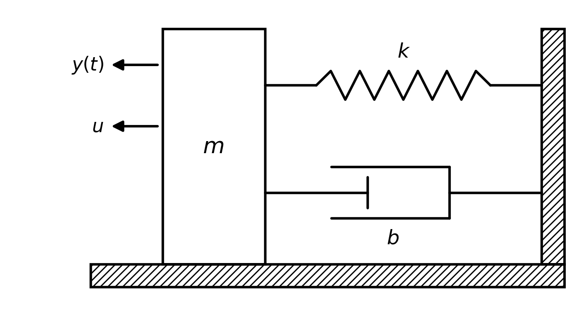
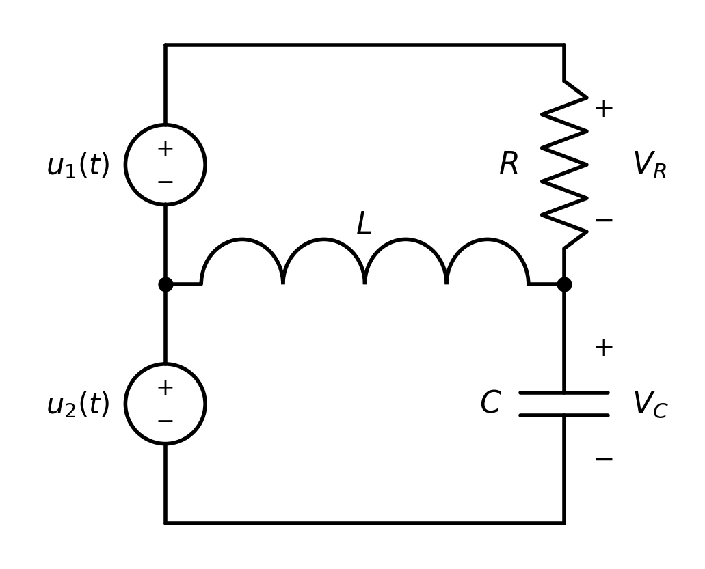

# Assignment 1: Linear Parametrisation, Estimation of Unknown Parameters, Least Squares Method

This brief was issued by the staff of the Modelling and Simulation of Dynamical Systems course (Department of Electrical and Computer Engineering, Aristotle University of Thessaloniki, 2021). Only the English translation is new. The two figures, which were images, are redrawn with the same content. The rules for submitting the work are left out.

The code that solves this brief is in [mass-spring-damper/](../mass-spring-damper/) and [rlc-circuit/](../rlc-circuit/); the report is [report.md](report.md). The file `v.p` that the second task refers to was supplied by the course; a copy is kept next to the code in [rlc-circuit/](../rlc-circuit/).

---

The aim of this laboratory exercise is the estimation of unknown parameters with the least-squares method.

## Task 1

The mass-spring-damper system shown in the figure below is given:



where $b$ is the damping constant, $k$ is the spring constant, $u$ is an external force and $y(t)$ is the displacement of the mass $m$ caused by the force applied to it.

1. Find the mathematical model that describes the dynamic behaviour of the system and parametrise it linearly, in the form

$$
y = \theta^{*T} \zeta
$$

where the signal $\zeta$ is produced from measurements of the external force $u$ and of the displacement $y$.

2. Design the least-squares algorithm for the estimation of the unknown parameters $m$, $b$ and $k$ when only the displacement and the external force applied to the mass are measured.

3. Simulate the algorithm you designed in the previous step, assuming $m = 15$ kg, $b = 0.2$ kg/s, $k = 2$ kg/s² and $u = 5\sin(2t) + 10.5$ N. Use samples every 0.1 s for 10 s, assuming zero initial conditions for the states of the system. Comment on the results.

## Task 2

The circuit of the figure below is given:



where $u_1(t) = 2\sin(t)$ V and $u_2(t) = 1$ V. In addition, only the voltages $V_R$ and $V_C$ at the terminals of the resistor and of the capacitor can be measured.

(a) Estimate, with the least-squares method, the transfer matrix of the circuit above. The voltages $V_R$ and $V_C$ are produced by the file `v.p`, by calling the function as follows:

```matlab
Vout=v(t);
```

For example:

```matlab
t=1.5;
Vout=v(t);
```

The variable `Vout` contains the voltages $V_R$ and $V_C$ at the time $t = 1.5$. $V_R$ = `Vout(1)`, $V_C$ = `Vout(2)`.

Note: the simulations are to be done with MATLAB functions that you choose yourself, based on the quality of the results they give.

(b) Assume that the measurements $V_R$ and $V_C$ are received erroneously (for example, produce the signals $V_R$ and $V_C$ as before and add, at 3 random time instants, some random numbers of a much larger order of magnitude than the normal values). Observe what impact this error has on the parameter estimates obtained with the least-squares method.
