# Assignment 1: Linear parametrisation and least-squares estimation of unknown parameters

5 April 2021

The assignment: [brief.md](brief.md). The code is in [mass-spring-damper/](../mass-spring-damper/) and [rlc-circuit/](../rlc-circuit/).

## 1 Task 1: mass-spring-damper system

### 1.1 Mathematical model and linear parametrisation

The mass-spring-damper system of the brief ($b$ is the damping constant, $k$ the spring constant, $u$ an external force and $y(t)$ the displacement of the mass $m$ caused by the force applied to it) is described by the second-order linear differential equation:

$$
\begin{aligned}
m\ddot{y} + b\dot{y} + ky = u
\end{aligned} \tag{1}
$$

By Newton's second law and the known relations for a linear spring and a linear damper, the equation can be written as:

$$
\begin{aligned}
\ddot{y} = -\frac{b}{m}\dot{y} - \frac{k}{m}y + \frac{1}{m}u
\end{aligned} \tag{2}
$$

The system is written in linearly parametrised form as:

$$
\begin{aligned}
\ddot{y} = \theta^{*T}\Delta
\end{aligned} \tag{3}
$$

where $\theta^{*} = \left[\frac{b}{m}\ \ \frac{k}{m}\ \ \frac{1}{m}\right]^{T}$ and $\Delta = \left[-\dot{y}\ \ -y\ \ u\right]^{T}$.

The second derivative of $y$ cannot be measured. So the Laplace transform is applied to (3) and both sides are filtered with the second-order filter $\frac{1}{\Lambda(s)}$, where $\Lambda(s) = s^{2} + \lambda_{1}s + \lambda_{2}$. This gives:

$$
\begin{aligned}
Y(s) = \vartheta_{\lambda}^{T}\zeta
\end{aligned} \tag{4}
$$

where $\vartheta_{\lambda} = \left[\frac{b}{m} - \lambda_{1}\ \ \frac{k}{m} - \lambda_{2}\ \ \frac{1}{m}\right]^{T}$ and $\zeta = \left[-\frac{sY(s)}{\Lambda(s)}\ \ -\frac{Y(s)}{\Lambda(s)}\ \ \frac{U(s)}{\Lambda(s)}\right]^{T}$.

Applying the inverse Laplace transform to (4) brings the system to the linearly parametrised form

$$
\begin{aligned}
y = \vartheta_{\lambda}^{T}\varphi
\end{aligned} \tag{5}
$$

where $\varphi$ is a function of the input $u$ and the output $y$, and the only unknown is the parameter vector $\vartheta_{\lambda}$.

### 1.2 The least-squares algorithm

Once the system is in the form (5), the least-squares method is used to estimate the unknown parameters. First $N$ measurements of the displacement $y$ and of the external force $u$ applied to the mass are taken, and the matrices

$$
Y = \left[ y(1)\ \ldots\ y(N) \right]^{T}
$$

and

$$
\Phi = \begin{bmatrix}
\varphi_{1}(1) & \cdots & \varphi_{3}(1) \\
\vdots & \ddots & \vdots \\
\varphi_{1}(N) & \cdots & \varphi_{3}(N)
\end{bmatrix}
$$

are built. Then $\vartheta_{0}$ follows from

$$
\begin{aligned}
\vartheta_{0}^{T}\Phi^{T}\Phi = Y^{T}\Phi
\end{aligned} \tag{6}
$$

where $\vartheta_{0} = \arg\min_{\vartheta}\frac{|e|^{2}}{2} = \arg\min_{\vartheta}\frac{e^{T}e}{2}$ and $e = Y - \Phi\vartheta$ is the total prediction error.

### 1.3 Simulation

The system is simulated with $m = 15$ kg, $b = 0.2$ kg/s, $k = 2$ kg/s² and $u = 5\sin(2t) + 10.5$ N, with zero initial conditions. `ode15s` integrates the state equations of (1) (the function `msd_dynamics`, in [msd_dynamics.m](../mass-spring-damper/msd_dynamics.m)) over each interval of 0.1 s, and the displacement is sampled at the end of each interval: 100 samples for 10 s. The code blocks of this report leave out the plotting commands; the whole script, which also draws all the figures, is [estimate_msd_parameters.m](../mass-spring-damper/estimate_msd_parameters.m).

```matlab
%parameters
m=15;
k=2;
b=0.2;

%initial state
y0(1) = 0;
y0(2) = 0;
u=@(t)5*sin(2*t)+10.5;
yy = zeros(100,2);
t = zeros(100,1);
```

```matlab
%simulation
for i=0:99
    [t_ode,y] = ode15s(@(t,state)msd_dynamics(t,state,m,b,k,u),[i*0.1 (i+1)*0.1],y0);
    y0(1)= y(end,1);
    y0(2) = y(end,2);
    yy(i+1,:) = y(end,:);
    t(i+1) = t_ode(end);
end
```

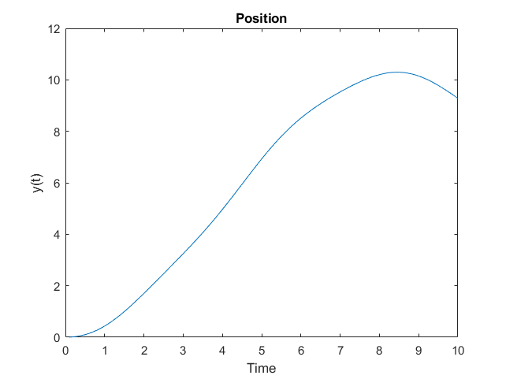

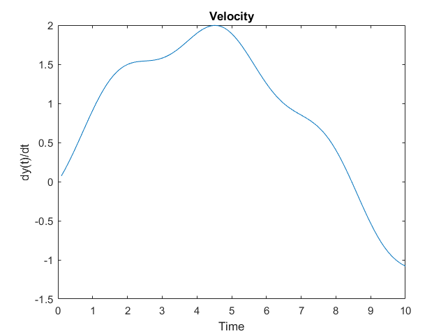

Next, the vector $U$ of samples of the external force at the same time instants as the displacement is created, together with the vector $Y$ of displacement samples:

```matlab
U = zeros(100,1);
for i = 1:100
    U(i) = u(t(i));
end

Y = yy(:,1);
```

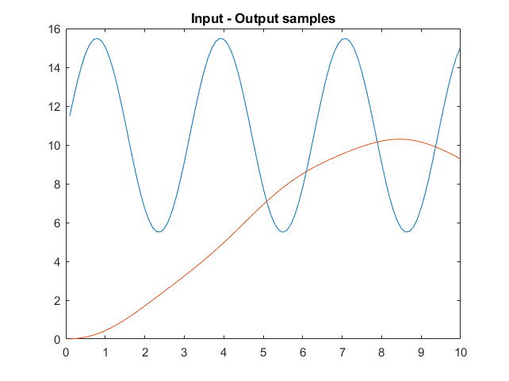

The matrix $\Phi$ is created with the function `lsim`, with the coefficients of the filter polynomial $\Lambda(s)$ chosen as $\lambda_1 = \lambda_2 = 10$:

```matlab
phi = zeros(100,3);
L = [ 1 10 10 ];
phi(:,1) = lsim(tf([-1 0],L),Y,t);
phi(:,2) = lsim(tf(-1,L),Y,t);
phi(:,3) = lsim(tf(1,L),U,t);
```

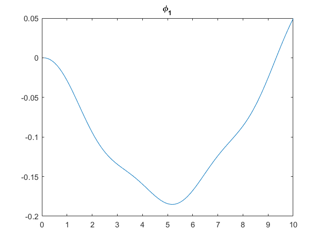

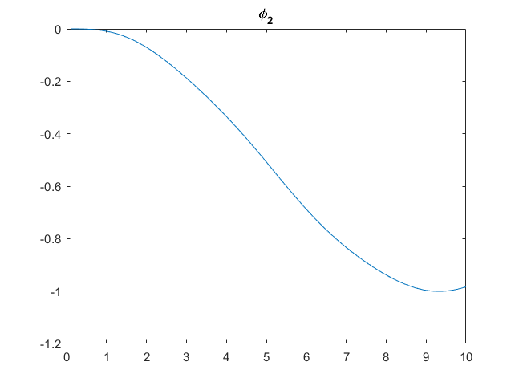

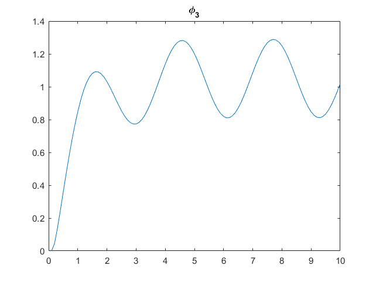

Finally $\vartheta_0$ is computed, and compared with the true parameter vector $\vartheta_{\lambda}$ of the simulated system:

```matlab
theta0 = inv(phi'*phi)*phi'*Y;

theta = [b/m-L(2) ; k/m-L(3) ; 1/m ];
error = theta -theta0;
error
```

```text
error =
   -0.0083
   -0.0012
   -0.0021
```

The estimate is $\vartheta_0 = [-9.9784\ \ -9.8655\ \ 0.0687]^{T}$ and the true vector is $\vartheta_{\lambda} = [-9.9867\ \ -9.8667\ \ 0.0667]^{T}$. With $\lambda_1 = \lambda_2 = 10$ this gives the estimates $\hat{m} = 14.55$ kg, $\hat{b} = 0.315$ kg/s and $\hat{k} = 1.957$ kg/s², against the simulated $m = 15$ kg, $b = 0.2$ kg/s and $k = 2$ kg/s². The parameter $b$ is the least accurate. The error is a sampling effect: it becomes smaller when the samples are taken more often (checked with steps of 0.05 s and 0.01 s).

## 2 Task 2: RLC circuit

### 2.1 Transfer matrix of the circuit

Let $i_1$ be the current of the loop that holds the source $u_1$ and the resistor $R$, and $i_2$ the current of the loop that holds the source $u_2$ and the capacitor $C$. The inductor $L$ is shared by the two loops. Kirchhoff's voltage law for the two loops and the relation of the capacitor give:

$$
\begin{aligned}
u_1(t) = v_R(t) + L\frac{d(i_1 - i_2)}{dt}
\end{aligned} \tag{7}
$$

$$
\begin{aligned}
u_2(t) = -L\frac{d(i_1 - i_2)}{dt} + v_C(t)
\end{aligned} \tag{8}
$$

$$
\begin{aligned}
i_2 = C\frac{dv_C(t)}{dt}
\end{aligned} \tag{9}
$$

together with Ohm's law $v_R = R i_1$. In the Laplace domain:

$$
\begin{aligned}
U_1(s) = V_R(s) + sL\left(I_1 - I_2\right)
\end{aligned} \tag{10}
$$

$$
\begin{aligned}
U_2(s) = -sL\left(I_1 - I_2\right) + V_C(s)
\end{aligned} \tag{11}
$$

$$
\begin{aligned}
I_2 = sC V_C(s)
\end{aligned} \tag{12}
$$

Substituting (12) into (11) gives

$$
\begin{aligned}
U_2(s) = -sL I_1 + \left(s^{2}LC + 1\right)V_C(s)
\end{aligned} \tag{13}
$$

and substituting (12) and $V_R = R I_1$ into (10) gives $U_1(s) = (R + sL)I_1 - s^{2}LC V_C(s)$, that is

$$
\begin{aligned}
I_1 = \frac{U_1(s) + s^{2}LC V_C(s)}{R + sL}
\end{aligned} \tag{14}
$$

Replacing $I_1$ from (14) in (13) and solving for $V_C$:

$$
\begin{aligned}
V_C(s) = \frac{sL}{s^{2}RLC + sL + R} U_1(s) + \frac{R + sL}{s^{2}RLC + sL + R} U_2(s)
\end{aligned} \tag{15}
$$

For the resistor voltage, (10) with $I_2$ from (12) and $V_R = R I_1$ gives $(R + sL)V_R(s) = R U_1(s) + s^{2}RLC V_C(s)$. Replacing $V_C$ from (15) gives

$$
\begin{aligned}
V_R(s) = \frac{s^{2}RLC + R}{s^{2}RLC + sL + R} U_1(s) + \frac{s^{2}RLC}{s^{2}RLC + sL + R} U_2(s)
\end{aligned} \tag{16}
$$

Together, (16) and (15) are the transfer matrix of the circuit from $(u_1, u_2)$ to $(v_R, v_C)$. All four entries have the same denominator. Adding the two equations gives $V_R(s) + V_C(s) = U_1(s) + U_2(s)$. Dividing numerators and denominators by $RLC$ shows the same result as the differential equations of the circuit:

$$
\begin{aligned}
\ddot{v}_R = -\frac{1}{RC}\dot{v}_R - \frac{1}{LC}v_R + \ddot{u}_1 + \frac{1}{LC}u_1 + \ddot{u}_2
\end{aligned} \tag{17}
$$

$$
\begin{aligned}
\ddot{v}_C = -\frac{1}{RC}\dot{v}_C - \frac{1}{LC}v_C + \frac{1}{RC}\dot{u}_1 + \frac{1}{RC}\dot{u}_2 + \frac{1}{LC}u_2
\end{aligned} \tag{18}
$$

### 2.2 Linear parametrisation and estimation

As in the previous task, each of the two equations (17) and (18) is filtered with $\frac{1}{\Lambda(s)}$, $\Lambda(s) = s^{2} + 10s + 10$, and brought to the form $v = \vartheta^{T}\varphi$, where $v$ is the output ($v_R$ or $v_C$). The regressors are

$$
\begin{aligned}
\varphi = \left[-\frac{sV}{\Lambda}\ \ -\frac{V}{\Lambda}\ \ \frac{sU_1}{\Lambda}\ \ \frac{U_1}{\Lambda}\ \ \frac{s^{2}U_2}{\Lambda}\ \ \frac{sU_2}{\Lambda}\ \ \frac{U_2}{\Lambda}\right]^{T}
\end{aligned} \tag{19}
$$

The first two entries of $\vartheta$ give the two coefficients of the common denominator, the other five the numerator coefficients of the paths from $u_1$ and $u_2$. The regressor $\frac{s^{2}U_1}{\Lambda}$ is not used. With the inputs of this task, $u_1 = 2\sin t$ and $u_2 = 1$, it cannot be told apart from $\frac{U_1}{\Lambda}$: for a sinusoid of angular frequency 1, $s^{2}u_1 = -u_1$, so only the difference of the two coefficients can be estimated. With all eight regressors the matrix $\Phi$ has rank 7 and the numerators are not determined by the data. The same estimator is used for $v_R$ and $v_C$, and the parameters are the least-squares solution of $v = \Phi\vartheta$ (in MATLAB, `phi\y`), as in (6):

```matlab
function H = least_squares_rlc(Vr,Vc,U,t,n)
% Least-squares estimate of the 2x2 transfer matrix from the two inputs
% (U(:,1) a sine, U(:,2) a constant) to the measured voltages Vr and Vc.
% H(1,:) maps the inputs to Vr, H(2,:) maps them to Vc. Both rows get the
% same denominator, as the two outputs share the dynamics.

L = [ 1 10 10 ];    % filter polynomial of the linear parametrisation

H = [ estimate_row(Vr,U,t,L) ; estimate_row(Vc,U,t,L) ];
end

function Hrow = estimate_row(y,U,t,L)
% Linear parametrisation y = theta'*phi with filtered signals phi.
% The s^2 term of the sine input is left out: for a sinusoid s^2*u = -u, so
% that regressor is linearly dependent on the one for u itself, and only the
% difference of the two coefficients can be identified from this input.
phi = [ lsim(tf([-1 0],L),y,t) ...
        lsim(tf(-1,L),y,t) ...
        lsim(tf([1 0],L),U(:,1),t) ...
        lsim(tf(1,L),U(:,1),t) ...
        lsim(tf([1 0 0],L),U(:,2),t) ...
        lsim(tf([1 0],L),U(:,2),t) ...
        lsim(tf(1,L),U(:,2),t) ];

theta = phi\y;

den = [1 theta(1)+L(2) theta(2)+L(3)];
Hrow = [ tf([0 theta(3:4).'],den) tf(theta(5:7).',den) ];
end
```

The function [least_squares_rlc.m](../rlc-circuit/least_squares_rlc.m) holds this, and the whole script, with the plotting commands that the code blocks of this report leave out, is [estimate_rlc_transfer_matrix.m](../rlc-circuit/estimate_rlc_transfer_matrix.m). The voltages come from the course-supplied function `v` ([v.p](../rlc-circuit/v.p)), sampled at $n = 100$ instants, $t = 0.01, 0.02, \ldots, 1$ s, with the inputs $u_1 = 2\sin t$ and $u_2 = 1$:

```matlab
n = 100;
Y = zeros(n,2);
U = zeros(n,2);
t = zeros(n,1);
for i=1:n
    t(i) = i*0.01;
    Y(i,:) = v(t(i));
    U(i,:) = [ 2*sin(t(i)) 1 ];
end
```

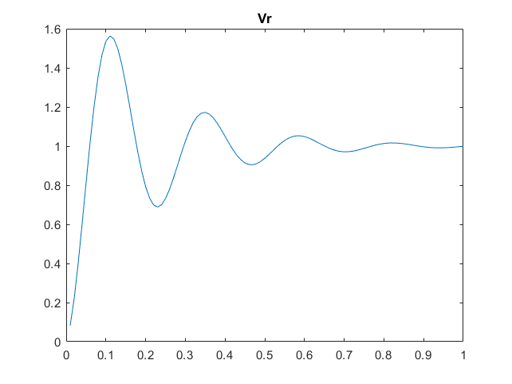

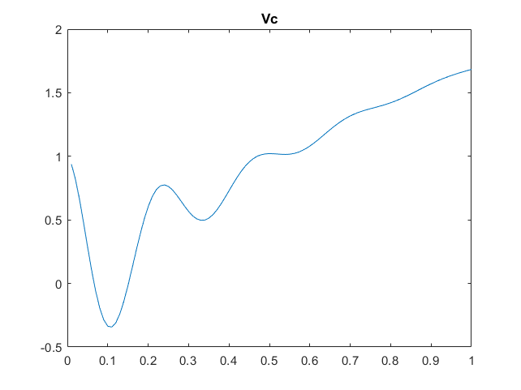

### 2.3 Result

The estimated transfer matrix, and the response of the system it describes:

```matlab
H = least_squares_rlc(Y(:,1),Y(:,2),U,t,n)
out1 = lsim(H(1,1),U(:,1),t);
out2 = lsim(H(1,2),U(:,2),t);
VR = out1 + out2;
out3 = lsim(H(2,1),U(:,1),t);
out4 = lsim(H(2,2),U(:,2),t);
VC = out3 + out4;
```

```text
H =

  From input 1 to output...
       0.0002933 s - 4.024e-06
   1:  -----------------------
        s^2 + 10.06 s + 734.3

          10.06 s + 733.3
   2:  ---------------------
       s^2 + 10.06 s + 734.3

  From input 2 to output...
       0.08185 s^2 + 12.02 s + 734.3
   1:  -----------------------------
           s^2 + 10.06 s + 734.3

       0.9381 s^2 + 0.04351 s - 2.894e-11
   2:  ----------------------------------
             s^2 + 10.06 s + 734.3

Continuous-time transfer function.
```


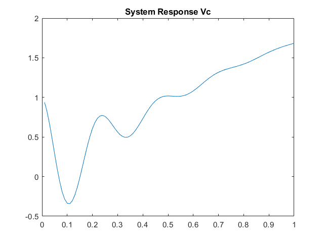

The response of the estimated system matches the measured voltages: the root-mean-square difference is 0.0023 for $v_R$ and for $v_C$, while both signals have a root-mean-square value of about 1. Both rows of the matrix have the same denominator, $s^{2} + 10.06s + 734.3$, as the transfer matrix (16), (15) requires. The numerators are a transfer matrix that reproduces the measured voltages; as explained above, the data (a sine and a constant) do not determine them uniquely. The only circuit quantities the denominator gives are $1/(RC) \approx 10.06$ and $1/(LC) \approx 734.3$.

The measured data satisfy $v_R + v_C = u_1 + u_2$ at every sample, as (16) and (15) require. But at low frequency the equations give $v_R \approx u_1$ and $v_C \approx u_2$, while in the data $v_R$ settles at the constant 1 and $v_C$ follows $2\sin t$. The measured voltages therefore behave as if the roles of the two sources were exchanged. The data also start from a non-zero state, $v_C(0) = 1$. The reason for the exchange is not known.

### 2.4 Measurements with errors

At three randomly chosen instants among the first ten samples, the measurements of both voltages are replaced by random numbers between 1 and 1000, which are of a much larger order of magnitude than the signals (a fixed seed makes the run repeatable), and the estimation is repeated:

```matlab
rng(1);    % fixed seed so that the run can be repeated
for i=1:3
    Y(randi([1,10],1,1),:) = randi([1,1000],1,2);
end

H2 = least_squares_rlc(Y(:,1),Y(:,2),U,t,n)
out1 = lsim(H2(1,1),U(:,1),t);
out2 = lsim(H2(1,2),U(:,2),t);
VR2 = out1 + out2;
out3 = lsim(H2(2,1),U(:,1),t);
out4 = lsim(H2(2,2),U(:,2),t);
VC2 = out3 + out4;
```

```text
H2 =

  From input 1 to output...
          7235 s + 4793
   1:  --------------------
       s^2 + 141.2 s + 4654

          3096 s + 5140
   2:  --------------------
       s^2 + 97.41 s + 3163

  From input 2 to output...
       263.6 s^2 + 2.314e04 s - 1.245e04
   1:  ---------------------------------
             s^2 + 141.2 s + 4654

       61.82 s^2 + 1.565e04 s - 7102
   2:  -----------------------------
           s^2 + 97.41 s + 3163

Continuous-time transfer function.
```

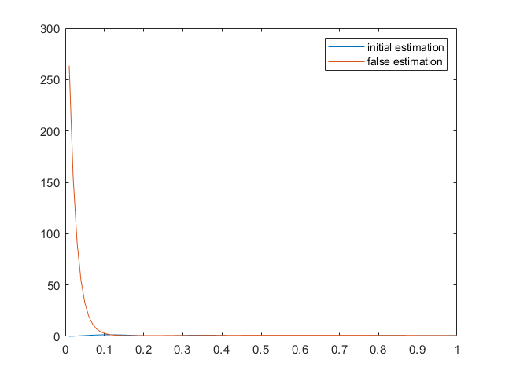

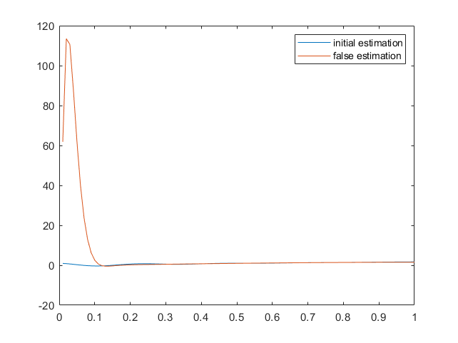

The erroneous samples change the estimates dramatically. The denominators move from $s^{2} + 10.06s + 734.3$ to $s^{2} + 141.2s + 4654$ for $v_R$ and $s^{2} + 97.41s + 3163$ for $v_C$, and the two rows no longer share a denominator. In the figures the response of the second estimate (orange) reaches values of about 260 for $v_R$ and 110 for $v_C$ at the start, while the signals of the first estimate (blue) stay below 2, so it is barely visible at this scale. The least-squares method weights every sample equally, so a few measurements that are far off dominate the sum of squared errors.
